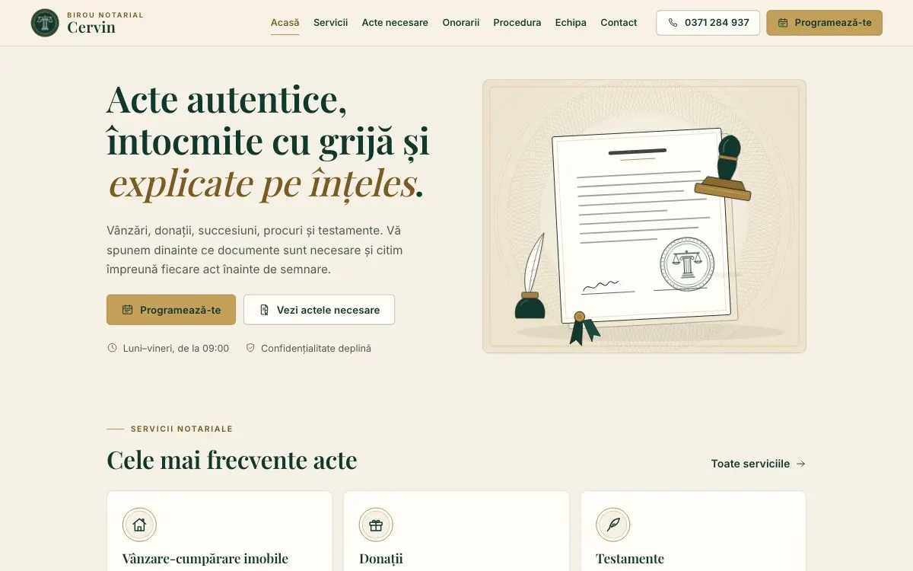

# Birou Notarial Cervin

Site de prezentare pentru un birou notarial: servicii, listă interactivă de acte necesare, estimator de onorarii, cronologia unei proceduri, echipă, programări, întrebări frecvente și pagini de contact și politici.



> **Proiect demonstrativ (portofoliu).** Biroul, persoanele, adresa, numerele de telefon, datele de înregistrare și onorariile sunt **fictive**. Textele au caracter general, nu reprezintă consultanță juridică și nu citează acte normative. Site-ul este marcat `noindex`, iar formularul de programare nu trimite nimic până nu conectați un backend (vezi mai jos). Nota „demo” apare intenționat doar aici, în README; site-ul arată ca unul final.

## Tehnologie

- **Next.js 16** cu export static (`output: "export"`), React 19, TypeScript, CSS simplu (`app/globals.css`).
- **Fără scripturi terțe și fără cereri externe**: fonturile (Playfair Display, Inter, licență OFL) sunt găzduite local, harta este un plan SVG desenat în pagină, ilustrațiile și iconițele sunt SVG originale.
- **Teste**: Vitest (logica pură) și Playwright + axe-core (fluxuri, tastatură, accesibilitate, zero cereri externe).

## Pornire

```bash
npm install
npm run dev          # http://localhost:3000
```

| Comandă | Ce face |
| --- | --- |
| `npm run clean` | șterge `.next/` și `out/` |
| `npm run build` | build static în `out/` |
| `npm run serve` | servește `out/` pe http://localhost:4191 (cu compresie, ca o găzduire reală) |
| `npm run lint` / `npm run typecheck` | ESLint / TypeScript |
| `npm run test:unit` | Vitest: lista de acte, estimatorul, validarea și adaptorul de programări |
| `npm run test:e2e` | Playwright pe telefon și desktop (**rulați întâi `npm run build`**) |
| `sh scripts/lighthouse.sh mobile` | Lighthouse pe toate paginile (rapoarte în `lighthouse/`) |

## Structură

```
app/                     paginile (fiecare folder = o adresă) și globals.css
  fonts/                 fonturile locale + subsetul „ro” pentru diacritice
components/              antet, subsol, bara de pe telefon, formular, estimator, listă de acte…
  illustrations/         sigiliu, portrete gravate, scena ștampilei, rozetă guilloche
config/site.ts           NUMELE AFACERII, contact, adresă, program, meniu, endpoint programări
data/
  services.ts            serviciile (descriere, durată estimativă, iconiță)
  documents.ts           listele de documente pe servicii și situații
  fees.ts                tabelul de onorarii și regulile (fictive) ale estimatorului
  staff.ts               echipa
  faq.ts                 întrebări frecvente
  procedure.ts           pașii procedurii
lib/
  checklist.ts           construirea listei de acte (pur, testat)
  fees.ts                estimatorul de onorarii, calcul în bani (pur, testat)
  appointment.ts         validarea cererii de programare (pur, testat)
  appointment-adapter/   trimiterea cererii: demo sau HTTP
tests/                   Playwright + axe
scripts/                 server static, Lighthouse, generator decor
```

## Editarea conținutului

Tot conținutul stă în fișiere de date tipizate; TypeScript semnalează orice câmp lipsă.

- **Servicii**: `data/services.ts`. Câmpul `infoOnly: true` (ca la traduceri) scoate serviciul din formularul de programare; `featured: true` îl afișează pe prima pagină.
- **Acte necesare**: `data/documents.ts`. Fiecare serviciu are `situations` (casetele „bifați ce se aplică”) și `groups` de documente. Un document cu `when: "id-situatie"` apare doar când situația e bifată. Testele verifică automat că fiecare serviciu are o listă și că fiecare `when` trimite la o situație existentă.
- **Onorarii**: `data/fees.ts`. `feeTable` este tabelul afișat; `saleFeeConfig` conține treptele estimatorului (`fixed + ratePercent × (valoare − from)`), minimul, TVA, taxa de carte funciară, impozitul vânzătorului și costurile fixe. Valorile actuale sunt inventate. Dacă schimbați treptele, testul „treptele sunt continue” vă spune dacă ați lăsat un salt între ele.
- **Echipa**: `data/staff.ts`; `figure` alege portretul ilustrat (`notary`, `deputy`, `clerk-a`, `clerk-b`, `clerk-c`).
- **Program, telefon, adresă, e-mail**: `config/site.ts`.

## Redenumire

Numele apare într-un singur loc: `BUSINESS_NAME` din `config/site.ts`. Logo-ul, titlurile paginilor, subsolul și textele îl preiau automat. Dacă noul nume începe cu „Birou Notarial”, logo-ul îl afișează pe două rânduri (de exemplu „BIROU NOTARIAL” / „Cervin”); altfel, îl afișează întreg. Pentru teste nu trebuie modificat nimic: ele citesc numele din același fișier.

## Conectarea unui backend real (programări)

Formularul folosește un adaptor (`lib/appointment-adapter/index.ts`):

- **fără configurare (demo)**: nu trimite nimic. Utilizatorul vede deschis „Cererea este pregătită, dar nu a fost trimisă”, plus un buton de apel și un e-mail deja completat;
- **cu endpoint**: trimite un `POST` JSON (`nume`, `telefon`, `email`, `serviciu`, `zi_preferata`, `mesaj`) și afișează „Cererea a fost trimisă”.

Pentru Formspree:

1. Creați un formular pe Formspree și copiați adresa (`https://formspree.io/f/xxxxxxx`).
2. Setați variabila la build, de exemplu în setările găzduirii (Netlify, Vercel etc.) sau într-un fișier local `.env.local` (ignorat de git):
   ```
   NEXT_PUBLIC_APPOINTMENT_ENDPOINT=https://formspree.io/f/xxxxxxx
   ```
3. Rulați din nou `npm run build`.

Același endpoint poate fi un serviciu propriu de e-mail sau o funcție serverless care acceptă JSON. Pentru alt format, scrieți un adaptor nou care respectă interfața `AppointmentAdapter` și întoarceți-l din `getAdapter()`. Odată conectat un backend, actualizați textul din `app/confidentialitate/page.tsx` (cine primește datele și cât timp le păstrează) și testul Playwright „în demo nu se trimite nimic”.

## Accesibilitate și animații

- Contrast WCAG AA verificat: alama pură `#A8843F` se folosește doar pentru linii și detalii; textul „alamă” folosește `#7A5C22`, iar butoanele alamă au fundal `#C2A05A` cu text verde.
- Navigare completă cu tastatura, „Sari la conținut”, meniu cu Escape, acordeon cu `aria-expanded`, rezumat de erori cu focus în formular.
- Animațiile (sigiliul desenat la încărcare, ștampila din hero, aparițiile la derulare, cronologia, tranzițiile între pagini) respectă `prefers-reduced-motion`: cu mișcare redusă, totul apare direct în starea finală.

## Rezultate verificate

- Lighthouse (build static servit local, cu compresie): performanță 96–98 pe telefon și 100 pe desktop; accesibilitate și bune practici 100; CLS 0 pe toate paginile. Scorul SEO de 60 este intenționat, din cauza `noindex`.
- Teste: 69 Vitest, 69 Playwright (telefon + desktop), axe fără erori pe toate paginile și stările formularului.

## Licențe

Codul și ilustrațiile sunt create pentru acest proiect. Fonturile Playfair Display și Inter sunt sub SIL Open Font License (`app/fonts/OFL-*.txt`).
